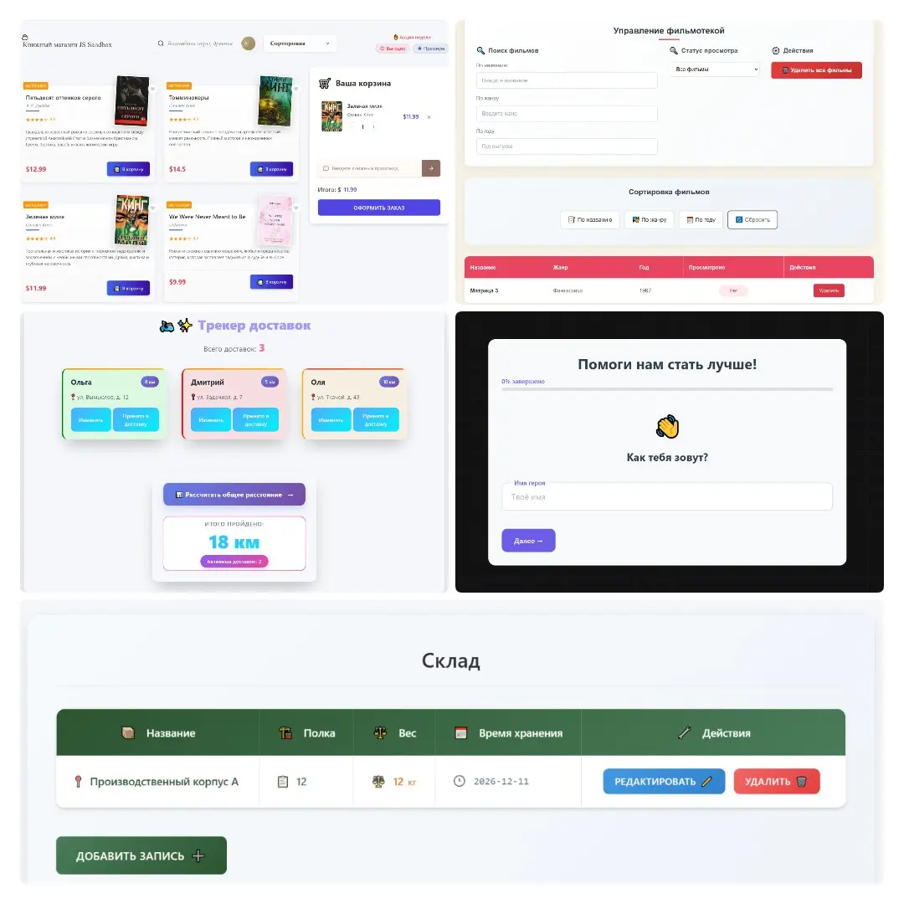

# 🎓 Vanilla-JS-Apps — сборник приложений на чистом JavaScript

[](https://developer.mozilla.org/ru/docs/Web/JavaScript)
[](https://vitejs.dev/)
[](https://sass-lang.com/)

> 🚀 Выполнено в рамках курса **«JavaScript»**  
> ✨ Профессия «Веб-разработчик на PHP 3.0» от Skillbox  
> 🎓 [Сертификат по «JavaScript»](public/docs/certificate-javascript.pdf)

**11 самостоятельных мини-приложений на Vanilla JS** — общая навигация, единый SCSS-слой, multi-page сборка на Vite.

🔗 **[Открыть демо](https://sanya481.github.io/Vanilla-JS-Apps/)**

---

## 💡 О проекте

Каждое приложение отрабатывает отдельную группу навыков: DOM и события, формы и валидация,
хранение данных в браузере, асинхронность, модульная архитектура.

Все проекты работают полностью на клиенте — данные хранятся в LocalStorage и cookie.



---

## 📚 Проекты

| Проект                                          | Описание                                               | Ключевые навыки                                   |
| ----------------------------------------------- | ------------------------------------------------------ | ------------------------------------------------- |
| 🛒 **[Книжный магазин](book-store.html)**       | Каталог с корзиной, поиском, сортировкой и промокодами | ES-модули, LocalStorage, cookie, рендер из данных |
| 📚 **[Домашняя библиотека](library.html)**      | Каталогизация книг, модальные окна                     | CRUD, работа с массивами, поиск и сортировка      |
| 🍿 **[Фильмотека](film-archive.html)**          | Список фильмов с фильтрами и сортировкой               | LocalStorage, фильтрация, динамический DOM        |
| 📝 **[Форма опроса](survey-form.html)**         | Пошаговая форма с валидацией и попапом результатов     | Form API, валидация, состояния UI                 |
| 🌿 **[Эко-доставка](delivery-form.html)**       | Расчёт доставки со скидками по бизнес-правилам         | Условная логика, вычисления, валидация полей      |
| 💳 **[CardCrafter](card-crafter.html)**         | Конструктор карточек с настройкой оформления           | DOM-генерация, динамические параметры             |
| 🔌 **[Мониторинг сети](network-monitor.html)**  | Отслеживание состояния соединения                      | Online/offline события, обработка ошибок          |
| 📷 **[Фотогалерея](portfolio.html)**            | Портфолио фотографа с лайтбоксом                       | Модальные окна, галерея, делегирование событий    |
| 🚛 **[Складской учёт](warehouse.html)**         | Учёт товаров, навигация между разделами                | ES-модули, CRUD, History API                      |
| ⏱️ **[Promise Loader](promise-loader.html)**    | Поочерёдная загрузка изображений с прогресс-баром      | Promise, async/await, Image API                   |
| 🛵 **[Трекер доставок](delivery-tracker.html)** | Отслеживание статусов доставки                         | Классы, таймеры, работа с датами                  |

---

## 🛠️ Технологии

**Язык и платформа**

- JavaScript ES6+: модули, деструктуризация, классы, spread/rest
- DOM API: создание элементов, делегирование событий
- Vite: multi-page сборка (12 точек входа), HMR

**Асинхронность**

- Promise, async/await, цепочки вызовов
- Обработка ошибок через try/catch
- Слой доступа к данным абстрагирован от источника — UI не зависит от способа получения данных

**Данные в браузере**

- LocalStorage — сохранение состояния между сессиями
- Cookie — хранение промокодов

**UI и стилизация**

- SCSS: переменные, миксины, партиалы, автоподключение через `additionalData`
- Модальные окна, попапы, переиспользуемый модуль уведомлений
- Кастомная валидация форм

---

## 📁 Структура

```
├── index.html                # Главная — навигация по проектам
├── book-store.html           # Точки входа проектов (Vite MPA, всего 12)
├── library.html
├── film-archive.html
├── survey-form.html
├── delivery-form.html
├── card-crafter.html
├── network-monitor.html
├── portfolio.html            # Фотогалерея LensArt
├── promise-loader.html
├── warehouse.html
├── delivery-tracker.html
├── public/
│   ├── assets/images/      # Превью-коллаж
│   ├── docs/               # Сертификат
│   └── favicon/            # Фавиконки, webmanifest
├── src/
│   ├── pages/                # Логика каждого проекта
│   │   ├── book-library/     # Библиотека (CRUD, модальные окна)
│   │   ├── book-store/       # Магазин (api/, components/, store.js)
│   │   ├── card-crafter/     # Конструктор карточек
│   │   ├── delivery/         # Эко-доставка (бизнес-правила, валидация)
│   │   ├── delivery-tracker/ # Трекер (классы, таймеры)
│   │   ├── film-archive/     # Фильмотека (фильтры, сортировка, LocalStorage)
│   │   ├── network-monitor/  # Мониторинг сети (online/offline события)
│   │   ├── photo-gallery/    # Галерея (лайтбокс, модальные окна)
│   │   ├── promise-loader/   # Загрузка изображений (Promise, прогресс-бар)
│   │   ├── survey-form/      # Опрос (валидация, попап результатов)
│   │   └── warehouse/        # Склад (CRUD, navigate.js, storage.js)
│   ├── scss/                 # base / components / pages / utils
│   ├── utils/notification/   # Переиспользуемые уведомления
│   └── assets/               # Шрифты, изображения
├── vite.config.js
├── package.json
└── README.md
```

---

## 🚀 Запуск локально

```bash
# Установка зависимостей
npm install

# Запуск dev-сервера
npm run dev

# Сборка для продакшена
npm run build

# Preview production builds
npm run preview
```

Dev-сервер откроется на `http://localhost:3000`

| Команда           | Действие                   |
| ----------------- | -------------------------- |
| `npm run dev`     | Dev-сервер с HMR           |
| `npm run build`   | Продакшен-сборка в `dist/` |
| `npm run preview` | Локальный просмотр сборки  |

